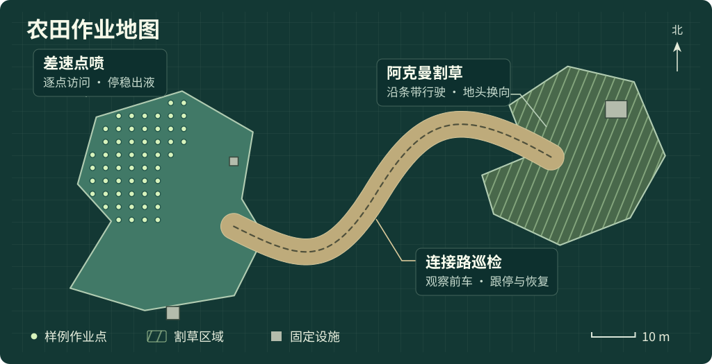
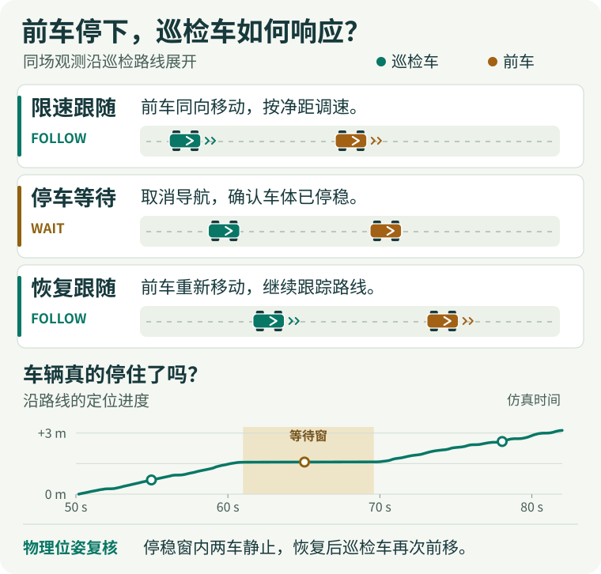
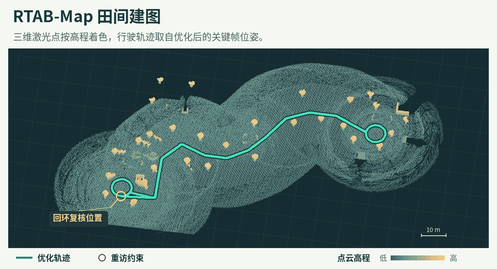
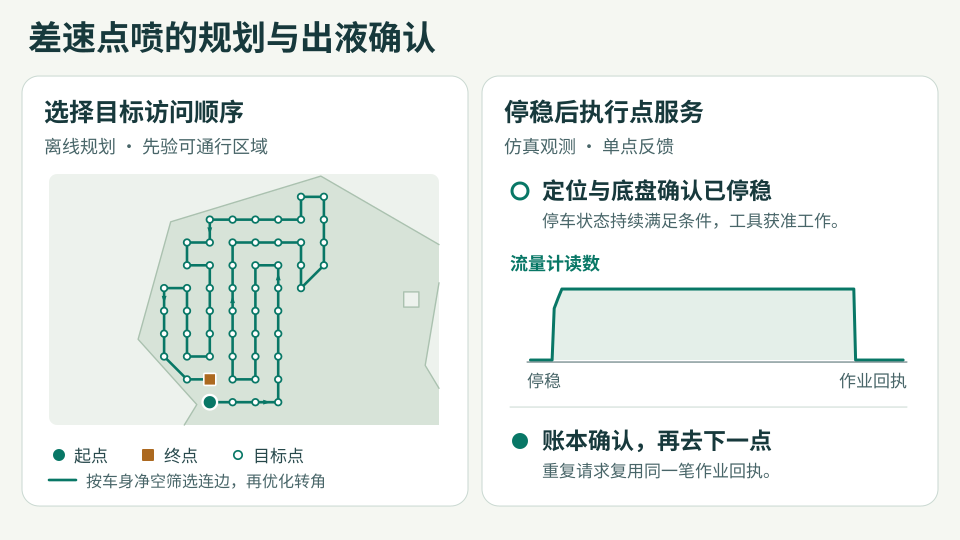
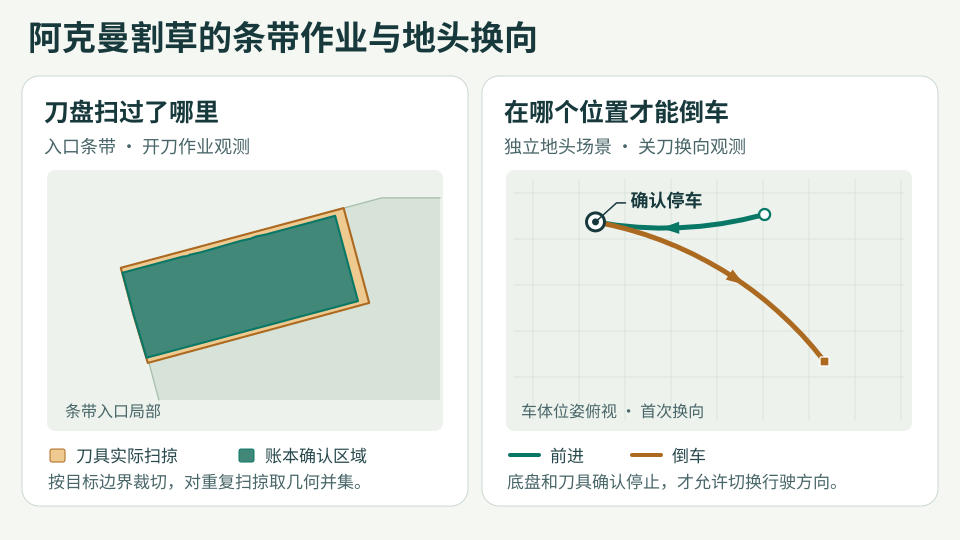

# ROS 2 农田多任务自主导航

农田连接路上的巡检车怎样判断前车停了？点喷车到了目标，怎样确认药液确实流出？阿克曼割草车在地头什么时候可以倒车？这个工程把三种任务放进同一张 Gazebo 农田地图，用传感器观测、行为树和底盘反馈回答这些问题。

[任务与数据图解](docs/demo.md) · [系统架构](docs/media/architecture.svg) · [在 Linux 上运行](docs/run.md)



地图按场景的先验边界和道路中心线绘制。浅色点是点喷规划样例的目标，斜纹标识割草区，曲线连接两个工作区。[场地先验](scenarios/farm/prior/)

## 连接路巡检

前车同向移动时，行为树根据跟踪净距选择跟随，Nav2 的 Regulated Pure Pursuit 控制差速车沿路行驶。前车停下后，监督器先取消导航，检查底盘是否停稳。前车重新拉开距离、跟随条件恢复后，巡检车接回剩余路线。



[行为树](src/field_navigation/config/inspection_tree.xml) · [取消与停车监督](src/field_navigation/include/field_navigation/supervision.hpp) · [复算跟停决策](examples/follow_stop_resume/README.md)

## RTAB-Map 建图与定位

建图时，同步双目图像、稳定激光表面和里程计形成关键帧。机器人再访同一区域时，通过几何配准检验回环，将沿途的激光扫描放到一致的地图坐标系。巡检时，轮速、IMU 和激光 ICP 提供连续运动估计，区域点云匹配和 GNSS 提供全局位置约束。



上图来自项目保存的完整建图任务。仓内提供短段同步观测，可在本地生成局部地图。另一组扫描可独立复核一个给定的重访候选。[查看点云配准前后](docs/demo.md#激光怎样检验重访) · [动手建图](src/field_mapping/example/README.md) · [定位与感知源码](src/field_bringup/README.md)

## 差速点喷

规划器先检查车体能否从一个点通行到另一个点，再在可达的连边上选择访问顺序。到点后，只有位置和车速持续满足精停条件才开启工具。流量反馈进入 SQLite 账本，确认本点作业后再派发下一点。



[点序求解](src/field_work/field_work/spray_planning.py) · [精停判据](src/field_work/field_work/docking.py) · [复算点喷作业](examples/spot_spray/README.md)

## 阿克曼条带割草

割草车根据后轴相对有向路径的横向与航向偏差修正曲率。开刀时按实际扫掠核算有效面积。到地头先关刀、停车，收到换向许可后再倒车。图中并列了条带入口作业与独立地头试验的两组观测。



[有向路径控制器](src/field_work/src/directed_path_controller.cpp) · [工具动作接口](src/field_interfaces/action/ToolTask.action) · [复算条带与换向](examples/strip_mowing/README.md)

## 构建与运行

工程环境为 Ubuntu 24.04、ROS 2 Jazzy 和 Gazebo Harmonic。C++ 实现 BehaviorTree.CPP 决策监督、Nav2 控制插件与工具动作，Python 负责传感器适配、任务编排、几何规划与反馈核对。[依赖、构建与启动说明](docs/run.md)

在已构建的工作区，从仓库根目录依次运行以下命令，可用随仓数据复算三个任务。

```bash
source /opt/ros/jazzy/setup.bash
source install/setup.bash
python3 tools/review_demo.py --case follow-stop-resume
python3 tools/review_demo.py --case spot-spray
python3 tools/review_demo.py --case strip-mowing
```

查看车辆实际运动可启动短程 Gazebo 跟停巡检。点喷和割草另提供工具接口、控制插件及观测案例。[短程驾驶](docs/run.md#复现一次短程跟停驾驶) · [作业组件](src/field_work/README.md) · [资源与许可](THIRD_PARTY_NOTICES.md)
