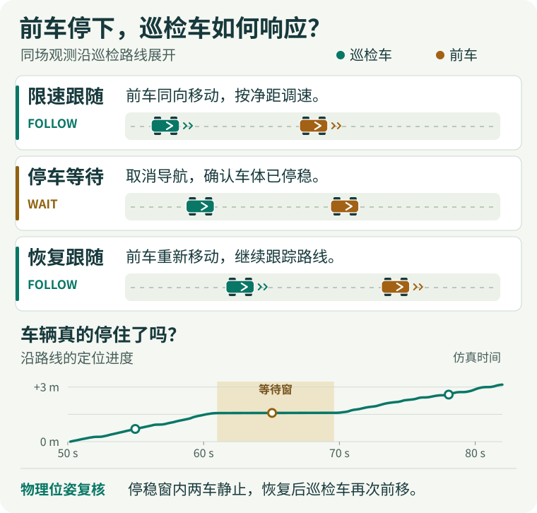
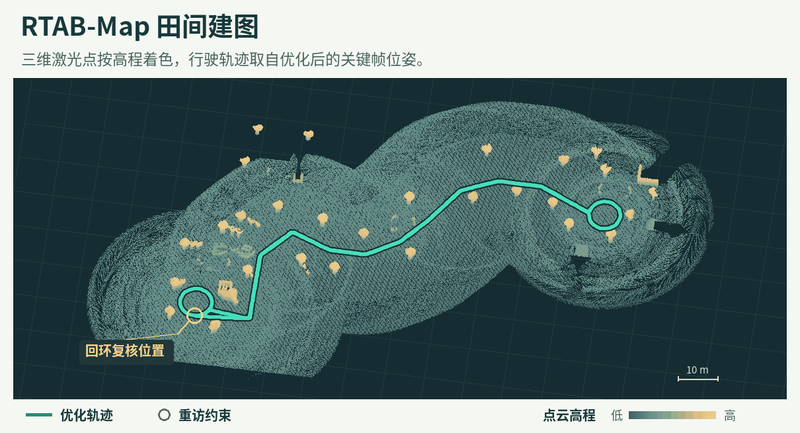
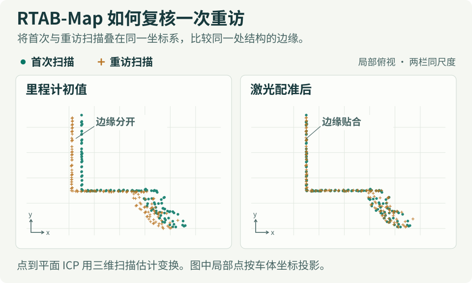
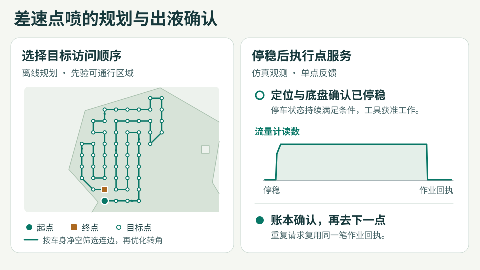
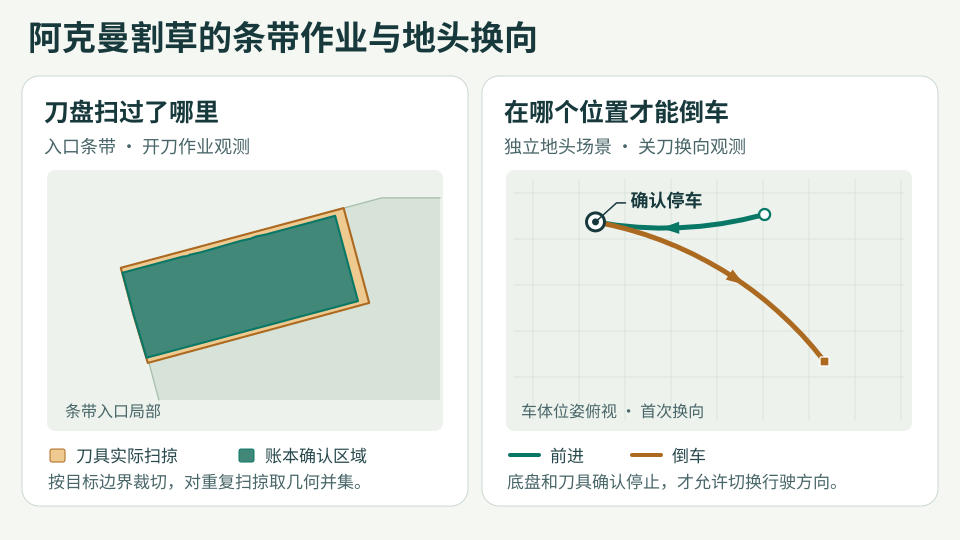
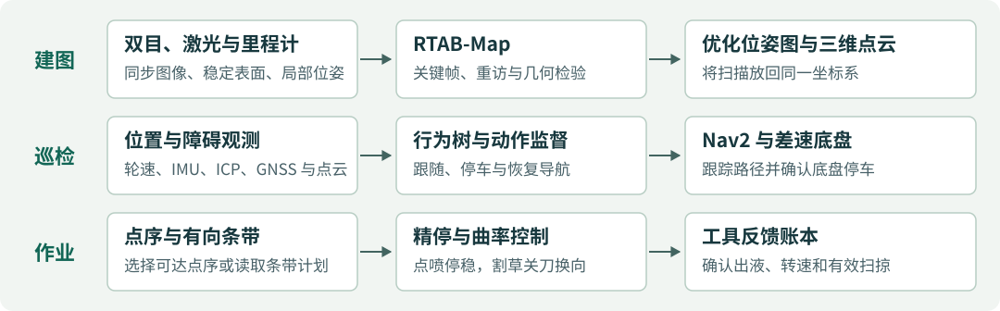

# 从观测看机器人如何工作

下列图解使用工程的场地几何、激光测量、任务指令和作业反馈绘制。每个场景都给出读图方法以及可自行运行的工程入口。

[巡检跟停](#巡检为什么停下又重新起步) · [建图回环](#激光怎样检验重访) · [定点喷洒](#一个点怎样算作完成) · [条带割草](#在哪里割草在哪里换向)

## 巡检为什么停下又重新起步

把弯曲连接路沿行驶方向展开，就能在同一方向比较前后车的位置。巡检车的位置来自沿线定位进度，前车符号根据当时的观测净距放置。`FOLLOW` 表示行为树选中了跟随，门控决定车辆此时是否获准移动。等待阶段先取消当前导航，导航空闲且底盘、工具确认停止后才保持 `WAIT`。下方是路线进度曲线，独立的物理位姿记录还可以核对停车期间的位移，以及恢复后的前移。[跟停数据与复算](../examples/follow_stop_resume/README.md) · [监督器的派发条件](../src/field_navigation/README.md)

## 激光怎样检验重访

整场图展示冻结地图的点云、关键帧位置与重访约束。随仓的短序列适合观察双目、激光和里程计怎样写入新地图。完整建图任务与短序列的观测范围分别标在图注和案例说明里。[短段观测与局部地图](../src/field_mapping/example/README.md)

在两幅图中找同一处折角。首次扫描用青色圆点表示，重访扫描用琥珀色十字表示。左图按两次里程计的相对朝向初始化，右图应用原生 RTAB-Map 在整对输入扫描上算出的变换。工程先计算配准，再与存档约束对照。放大局部便于看清错开的边缘怎样贴合。[输入扫描](../src/field_mapping/example/observations.json) · [C++ 几何复核](../src/field_mapping/src/verify_loop.cpp) · [运行复核](../src/field_mapping/README.md)

## 一个点怎样算作完成

左图是离线规划。地图和足迹决定哪些点之间允许通车，求解器在起终点与路长约束下选择访问顺序。右图用单点作业观测说明执行过程。先确认停稳，再看流量计有没有检测到出液，最后检查账本确认与下一点派发事件。重复下发同一作业请求时，可用幂等键核对是否重复计量。[规划输入](../examples/spot_spray/planning.json) · [流量与账本复算](../examples/spot_spray/README.md) · [反馈账本实现](../src/field_work/field_work/ledger.py)

## 在哪里割草，在哪里换向

左图取条带入口处的开刀作业。刀具扫掠按目标边界裁切，再与账本确认几何叠加。重叠区域用并集去重。右图来自另一次关刀地头试验，画出第一次换向前后的车体轨迹，停车反馈与换向授权可以对照。读图时，左边看刀具覆盖了哪里，右边看底盘在哪个位置从前进切到倒车。[条带、停车与面积数据](../examples/strip_mowing/README.md) · [阿克曼曲率控制](../src/field_work/src/directed_path_controller.cpp)

## 从传感器到执行器

建图分支输出优化位姿与地图。在线巡检把跟踪、定位和通行观测交给行为树，Nav2 产生候选速度，再由门控决定底盘能否执行。作业端单独接收工具反馈，确认出液或有效扫掠。[巡检系统装配](../src/field_bringup/README.md) · [作业动作与控制插件](../src/field_work/README.md) · [构建与运行](run.md)
